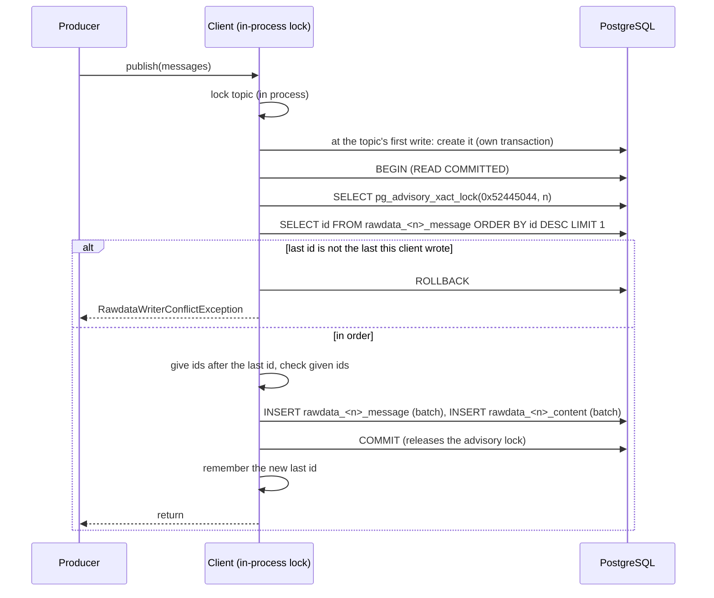

# The `postgres` provider

`rawdata-client-provider-postgres` stores topics in PostgreSQL 18, the only version it supports and is tested
against. Choose it when your system already runs PostgreSQL, when you want a published message to be visible and
durable the moment `publish` returns, or when you want to look at the data with SQL. Your code uses the
`RawdataClient` API only; the provider is picked by configuration.

| | |
|---|---|
| Maven | `io.descoped.rawdata:rawdata-client-provider-postgres`, version managed by `rawdata-client-bom` |
| JPMS module | `io.descoped.rawdata.provider.postgres` (exports nothing) |
| Provider name | `postgres` (`rawdata.client.provider=postgres`) |
| Database | PostgreSQL 18 |
| Brings | HikariCP (connection pool), the PostgreSQL JDBC driver (pgjdbc), slf4j-api |

## Contents

- [Quick start](#quick-start)
- [Concepts](#concepts)
- [How it works](#how-it-works)
- [Configuration](#configuration)
- [Database setup and privileges](#database-setup-and-privileges)
- [Failure modes and troubleshooting](#failure-modes-and-troubleshooting)
- [Testing](#testing)
- [Reference](#reference)
- [See also](#see-also)

## Quick start

1. Start PostgreSQL 18. The module has a Compose file for local work:

   ```sh
   cd rawdata-client-provider-postgres
   docker compose up -d
   ```

   It listens on port 5432 with user `rdc`, password `rdc` and database `rdc` (see
   [the local database](#the-local-database)).

2. Import the BOM and add the API and the provider. The provider is only needed at run time:

   ```xml
   <dependencyManagement>
       <dependencies>
           <dependency>
               <groupId>io.descoped.rawdata</groupId>
               <artifactId>rawdata-client-bom</artifactId>
               <version>3.0.1</version>
               <type>pom</type>
               <scope>import</scope>
           </dependency>
       </dependencies>
   </dependencyManagement>

   <dependencies>
       <dependency>
           <groupId>io.descoped.rawdata</groupId>
           <artifactId>rawdata-client-api</artifactId>
       </dependency>
       <dependency>
           <groupId>io.descoped.rawdata</groupId>
           <artifactId>rawdata-client-provider-postgres</artifactId>
           <scope>runtime</scope>
       </dependency>
   </dependencies>
   ```

3. Create a client, publish and read:

   ```java
   import io.descoped.rawdata.api.RawdataClient;
   import io.descoped.rawdata.api.RawdataConsumer;
   import io.descoped.rawdata.api.RawdataMessage;
   import io.descoped.rawdata.api.RawdataProducer;

   import java.nio.charset.StandardCharsets;
   import java.time.Duration;
   import java.util.Map;

   Map<String, String> configuration = Map.of(
           RawdataClient.PROVIDER_KEY, "postgres",        // "rawdata.client.provider"
           "postgres.driver.host", "localhost",
           "postgres.driver.user", "rdc",
           "postgres.driver.password", "rdc",
           "postgres.driver.database", "rdc");

   try (RawdataClient client = RawdataClient.create(configuration)) {
       try (RawdataProducer producer = client.producer("invoices")) {
           producer.publish(RawdataMessage.builder()
                   .position("invoice-1001")
                   .put("document", "<invoice/>".getBytes(StandardCharsets.UTF_8))
                   .build());
       }   // in postgres the message is already committed when publish returns

       try (RawdataConsumer consumer = client.consumer("invoices")) {
           for (RawdataMessage message : consumer.receiveUpTo(100, Duration.ofSeconds(5))) {
               System.out.println(message.id() + " " + message.position());
           }
       }
   }
   ```

   The first client creates the schema's registry of topics if it is missing, and a topic gets its tables at its first
   write. Nothing else needs setting up in the database.

The rest of this page explains what happens underneath, so you can reason about order, failures and capacity.

## Concepts

The API's concepts (topics, messages, ids, positions, cursors, metadata, one writer per topic) are explained in
[concepts](../concepts.md). This section covers what the `postgres` provider adds to them.

### Each topic has tables of its own

Each topic has three tables of its own. Topics of different sensitivity, public register data next to tax reports,
never share a table, so each can be granted on its own, and a large topic never weighs on the others. A topic's tables
are created in one transaction at its first write (a publish or a metadata `put`), and nothing is ever dropped.
Reading a topic that has not been written yet finds nothing and creates nothing.

A topic's tables are named by its number `n` in the schema's registry, `rawdata_topic`, never by the topic name. The
topic is only ever a bind parameter, so a topic name cannot inject SQL, is never cut to PostgreSQL's 63-byte
identifiers, and two names never meet in one table. (The tests publish to a topic named `Robert.DROP-TABLE_students`
and check that its tables are `rawdata_1_*`.)

| Table | One row per | Primary key | Also |
|---|---|---|---|
| `rawdata_topic` | topic of the schema, with its number `n` | `topic` | `n` unique, generated |
| `rawdata_probe` | the word `rawdata-probe` and its hash | `word` | guards the position hash, see [the position's hash](#the-positions-hash) |
| `rawdata_<n>_message` | message: id, position, the position's hash, ordering group, sequence number | `id` | index `rawdata_<n>_position` on `(position_hash, id)` |
| `rawdata_<n>_content` | named content of a message, with its `ordinal` (the order the keys were added) | `(id, ordinal)` | foreign key to the message table, `ON DELETE CASCADE` |
| `rawdata_<n>_metadata` | metadata entry of the topic | `name` | |

The columns, as [`PostgresSchema`][PostgresSchema.java] and [`PostgresTopics`][PostgresTopics.java] create them:

```sql
rawdata_topic        (topic varchar(100) COLLATE "C", n integer GENERATED ALWAYS AS IDENTITY)
rawdata_probe        (word text COLLATE "C", hash bigint GENERATED ALWAYS AS (hashtextextended(word, 0)) STORED)
rawdata_<n>_message  (id uuid, position varchar COLLATE "C",
                      position_hash bigint GENERATED ALWAYS AS (hashtextextended(position, 0)) STORED,
                      ordering_group varchar, sequence_number bigint)
rawdata_<n>_content  (id uuid, ordinal integer, name varchar, data bytea)
rawdata_<n>_metadata (name varchar COLLATE "C", data bytea)
```

Every column is `NOT NULL` except `ordering_group`. The tables are in the schema `postgres.schema` names (`public` by
default); one schema per class of data keeps their grants apart (see [privileges](#database-setup-and-privileges)).

### The position's hash

A seek by position is a search for a value of any length, which no btree entry holds (PostgreSQL limits one to
2704 bytes). The position is therefore stored as it is, and searched through its hash: `position_hash` is
`hashtextextended(position, 0)`, a 64-bit hash that PostgreSQL computes when a row is inserted, kept in a stored
generated column and indexed with the id. The client computes nothing. A seek compares the full position as well, so
two positions with the same hash never match each other. `COLLATE "C"` makes both the hash and the comparison depend on
the bytes alone, never on a collation library.

`hashtextextended` is PostgreSQL's own hash, the one behind hash indexes and hash partitioning: it works where MD5 is
disabled (FIPS mode). It is not a documented function, so a major version could in principle hash differently. A
restore (`pg_dump`) recomputes stored generated columns; only `pg_upgrade` keeps them, and would then leave hashes a
seek no longer finds. `rawdata_probe` keeps a word and its hash in the same kind of column, so it is recomputed and kept
exactly when the topics' hashes are. Every client start compares it with the server's hash of the word, and a
mismatch stops the start with the statements that recompute the hashes (see
[troubleshooting](#failure-modes-and-troubleshooting)).

### Ids are PostgreSQL UUIDv7s

A message's id is stored in a native `uuid` column. The ids that `RawdataIds` makes have the layout of PostgreSQL 18's
own `uuidv7()`, so `uuid_extract_version(id)` returns 7 and `uuid_extract_timestamp(id)` returns the time the
message was published. PostgreSQL sorts `uuid` as an unsigned 128-bit number, which is exactly `RawdataIds.ORDER`, so
`ORDER BY id` in SQL is the order consumers read in. The tests check both facts against a real database.

### The topic lock

A publish takes a PostgreSQL advisory lock for its topic, `pg_advisory_xact_lock(0x52445044, n)` with the topic's
number `n`, and holds it until its transaction commits or rolls back. The lock is what orders writes: while one publish
holds it, no other publish to that topic, from any client or process, can read the topic's end or insert. Advisory
locks are taken through SQL and need no privilege beyond connecting.

The class `0x52445043` ("RDPC") is taken for creating the registry (key 0) and for creating a topic (key
`hashtext(schema.topic)`), so clients that create the same thing at once wait for each other. Two topics of one schema
never share a publish lock. Advisory locks belong to the database, so topics with the same number in two schemas of
one database share a key: their publishes take turns, which never changes what either topic holds.

### Writes are visible when `publish` returns

The provider has no buffer. `publish` writes the whole call in one transaction and commits before it returns. When
`publish` returns, every consumer in every process can read the messages, and they survive a crash of your process.
When it throws, nothing of that call was written. This is the main difference from the Avro providers (`filesystem`,
`gcs`, `s3`), which collect messages in an upload window first.

### The one-writer check

Only one process writes a topic (see [concepts](../concepts.md)). The provider checks it on every publish. A client
remembers, per topic, the last id it wrote. Under the topic lock, a publish reads the topic's last id in the database
and compares:

- Before the client's first publish to the topic, there is nothing to compare: the publish appends after whatever
  the topic holds.
- After that, the topic's last id must be the one this client wrote last. If it is not, another process has written
  since. The publish throws `RawdataWriterConflictException` (which names the topic), rolls back and writes nothing.

The check never passes again for that topic in that client, because the remembered id does not change. Producers of
one client take turns on a per-topic lock in the client before they take the database lock, so they never look like
another writer to each other.

### One connection pool per client

Each `RawdataClient` owns a HikariCP pool named `rawdata-postgres`. Every operation (a publish, a consumer's fetch,
`lastMessage`, `cursorOf` by position, each metadata call) borrows a connection for one short transaction and
returns it. No connection is held between calls, not even by an idle consumer. Closing the client closes its pool and
its connections.

## How it works

### Start-up

`RawdataClient.create` finds `PostgresRawdataClientInitializer` through the service loader by its name, `postgres`,
and calls `initialize`:

1. It reads the configuration. A missing or blank user, password or database, or a number key that is not a positive
   whole number, fails with `IllegalArgumentException` naming the key.
2. It creates the pool. Every connection has auto-commit off, transaction isolation READ COMMITTED, and
   `ApplicationName=rawdata-postgres`. Creating the pool opens a first connection: a database that cannot be
   reached, a database that does not exist, or a wrong password fails here with `RawdataException`, never later as
   an empty topic.
3. It checks that the schema `postgres.schema` exists, and fails with `RawdataException` if it does not.
4. It creates the registry if needed. It checks with `to_regclass` whether `rawdata_topic` and `rawdata_probe` exist.
   If they do, it creates nothing, so a role that may only read can start. If not, it takes the registry lock and
   creates both in one transaction. Clients that start at the same time wait for each other on the lock, so they are
   created once.
5. It checks the probe: the stored hash of `rawdata-probe` must be the server's (see
   [the position's hash](#the-positions-hash)).

A topic's tables are created at its first write, by [`PostgresTopics`][PostgresTopics.java], in one transaction: take
the topic's creation lock, look the topic up again (another client may have created it meanwhile), insert it into
`rawdata_topic` to get its number, and create its three tables and the position index. A failure rolls all of it back.
The client remembers each topic it has found.

### A publish



In words, [`PostgresRawdataProducer.write`][PostgresRawdataProducer.java]:

1. Take the client's in-process lock for the topic. At the topic's first write, create it.
2. Begin a transaction and take the topic's advisory lock. If another publish holds it, wait.
3. Read the topic's last id (or the beginning of time for an empty topic).
4. Run the one-writer check.
5. Give each message without an id the next id after the greatest so far (`RawdataIds.next`). A message with an id
   of its own, as the copy tool gives, keeps it, in any order; a message already stored under its id is left out
   (the same message again is a no-op), and a different one fails the call with `RawdataDuplicateIdException`.
6. Insert one message row per message and one content row per content key, as two JDBC batches. PostgreSQL computes
   each position's hash.
7. Commit, which releases the advisory lock, and remember the last id written.

Any failure in steps 2 to 7 rolls the transaction back: the call is written whole or not at all. The tests publish a
good message together with a different message under an id already stored, and check that neither the good message
nor its content was stored.

`publishAsync` runs the same `publish` on the client's thread pool (daemon threads named `rawdata-postgres-<n>`).

### Why generated ids grow in commit order

A consumer reads "the messages with an id greater than the last one I read". The topic lock makes the ids the
producer generates grow in commit order, so a consumer never misses one of them:

- The lock is held from before the topic's greatest id is read until after the commit, so publishes to a topic
  happen one at a time.
- Each publish generates ids after the greatest committed id.

A given id is stored as it is, as in 2.x, and may be lower than ids already committed; a consumer already past it
does not read it.

An id is unique within a topic, as in every provider. When a call gives ids, the publish reads the messages already
stored under them, in the same transaction. A message stored with the same position, ordering group, sequence number
and content (the same keys in the same order, the same bytes) is left out, and the rest of the call is written. A
different one is refused with `RawdataDuplicateIdException`, and nothing of the call is written. A repeated message is
already at or below the topic's greatest id, so it does not change the one-writer check. A call without given ids
skips the read.

This depends on the read in step 3 seeing every commit made before the lock was granted. Under READ COMMITTED each
statement takes a fresh snapshot, so it does. Under REPEATABLE READ the snapshot would be taken by the lock statement,
before the wait, and the read could miss the previous holder's commit. That is why the pool sets READ COMMITTED on
every connection, whatever `default_transaction_isolation` the database or role has. The tests set the role's default
to REPEATABLE READ, hold the topic lock from another connection, commit a message with an id an hour in the future,
and check that the waiting publish gives an id after it.

### Reading

[`PostgresRawdataConsumer`][PostgresRawdataConsumer.java]
reads a topic in pages. Each fetch is one query that selects up to `rawdata.postgres.consumer.prefetch-size` messages
after (or, for an inclusive start, from) an id, ordered by id, joined with their content ordered by `ordinal`.
`receive` and `receiveUpTo` take messages from that page; when the page is empty, the next call fetches again.

When a fetch finds nothing, the receive waits
`rawdata.postgres.consumer.prefetch-poll-interval-when-empty` milliseconds (or until its timeout, if that is
sooner) and fetches again. A publish through the same client wakes that client's waiting consumers of the topic,
which fetch at once, as the Avro providers' consumers do after an upload
(`rawdata.postgres.consumer.wake-on-publish`, on by default). A message from another process is seen up to one poll
interval after its commit; 250 ms by default.

Where a consumer starts:

| You call | It starts at |
|---|---|
| `client.consumer(topic)` | the beginning of the topic |
| `client.consumer(topic, id)` | the first message after `id` |
| `client.consumer(topic, id, true)` | `id` itself if a message has it, else the first after |
| `client.consumer(topic, position, approxTimestamp, tolerance)` | after the first message with that position, searched in the time window (see below) |
| `consumer.seek(timestamp)` | the first message whose id's time is at or after `timestamp` |

`cursorOf(topic, position, inclusive, approxTimestamp, tolerance)` is one query on the `(position_hash, id)` index,
comparing the full position too, limited to ids whose time is in
`[approxTimestamp - tolerance, approxTimestamp + tolerance]`. It returns the first
such message by id, or throws `RawdataNoSuchPositionException`. A cursor from one `postgres` client works with any
`postgres` client; a cursor from another provider is refused with `IllegalArgumentException`.

`lastMessage(topic)` is one query for the greatest id with its content, or null for an empty topic. A topic not
written yet reads as empty everywhere: a consumer finds nothing and looks the topic up again at its next poll,
`lastMessage` returns null, and a seek by position throws `RawdataNoSuchPositionException`.

### Metadata

[`PostgresRawdataMetadataClient`][PostgresRawdataMetadataClient.java]
keeps each entry as a row of the topic's metadata table. Each call is its own transaction:

| Call | SQL | Topic not written yet |
|---|---|---|
| `keys()` | `SELECT name ... ORDER BY name`: a sorted, unmodifiable snapshot | an empty set |
| `get(key)` | `SELECT data ...`, or null; read when called, never cached | null |
| `put(key, value)` | `INSERT ... ON CONFLICT (name) DO UPDATE` | creates the topic first |
| `remove(key)` | `DELETE ...`; nothing happens for a missing key | nothing happens |

Metadata writes do not take the topic lock and are not part of the one-writer check.

**Limits.** The limits are the API's, the same in every provider: a metadata key of at most 127 bytes in UTF-8, well
within a btree entry, and a position and a publish call as configured by `rawdata.limits.max-position-bytes` and
`rawdata.limits.max-publish-bytes` (see [concepts](../concepts.md)). Nothing in the tables limits a position or a
content key further: a position is indexed by its hash, and a content key is not indexed. A call over a limit is
refused with `IllegalArgumentException` before the database sees it.

### Closing

`client.close()` closes the client's producers and consumers, stops its thread pool (pending `publishAsync` and
`receiveAsync` calls fail with `RawdataClosedException`) and closes the connection pool. A receive that is waiting
fails with `RawdataClosedException`, and so does a publish under way: closing the pool aborts its transaction, so it
writes nothing. A publish that waited for its turn while its producer closed writes nothing either. After that every
method throws `RawdataClosedException`, except `isClosed()` and `close()`. Closing a producer does not flush anything,
because nothing is buffered.

## Configuration

Pass these keys in the map given to `RawdataClient.create`. The whole map goes to the provider.

| Key | Default | Meaning |
|---|---|---|
| `rawdata.client.provider` | none, required | `postgres` |
| `postgres.driver.host` | `localhost` | host name or address of the database server |
| `postgres.driver.port` | `5432` | port; a positive whole number |
| `postgres.driver.user` | none, required | database role |
| `postgres.driver.password` | none, required | the role's password |
| `postgres.driver.database` | none, required | database name; it must exist |
| `postgres.driver.max-pool-size` | `10` | most connections the client's pool opens; a positive whole number |
| `postgres.schema` | `public` | the schema of the client's topics: a-z, 0-9 and `_`, at most 63, not starting with a digit. It must exist. One schema per class of data keeps their grants apart |
| `rawdata.limits.max-position-bytes`, `rawdata.limits.max-publish-bytes` | `2000`, 256 MiB | the limits of a publish, the same keys in every provider (see [concepts](../concepts.md)) |
| `rawdata.postgres.consumer.prefetch-size` | `100` | most messages a consumer reads per query; a positive whole number |
| `rawdata.postgres.consumer.prefetch-poll-interval-when-empty` | `250` | milliseconds a consumer that found nothing waits before it queries again; a positive whole number |
| `rawdata.postgres.consumer.wake-on-publish` | `true` | whether a publish wakes the same client's waiting consumers of the topic, which then query at once; `true` or `false` |
| `rawdata.postgres.publish.lock-timeout-ms` | none | milliseconds a publish waits for the topic lock, or any other lock it needs (an operator's `ALTER TABLE`, say), before it fails with `RawdataException` (SQLState `55P03`), writing nothing; a positive whole number. Without it, a publish waits as long as the lock is held |
| `postgres.driver.tcp-keep-alive` | `false` | TCP keep-alive on the connections, so the operating system notices a server or network that vanished; `true` or `false` |
| `postgres.driver.ssl-mode` | pgjdbc's, `prefer` | `disable`, `allow`, `prefer`, `require`, `verify-ca` or `verify-full`, any case, as pgjdbc's `sslmode`. Only `verify-ca` and `verify-full` check the server's certificate |
| `postgres.driver.ssl-root-cert` | pgjdbc's | the file of certificates that sign the server's, as pgjdbc's `sslrootcert`; only with `ssl-mode` `verify-ca` or `verify-full`, and refused with any other mode, where it would be ignored |

Fixed settings, not configurable: auto-commit off, READ COMMITTED, `ApplicationName=rawdata-postgres`, pool name
`rawdata-postgres`, and HikariCP's defaults for everything else (for example, a caller waits at most 30 seconds for
a free connection). Every statement names the schema; the role's `search_path` plays no part.

Choosing values:

- **`max-pool-size`** bounds how many operations of one client run in the database at the same time. Publishes to
  one topic run one at a time anyway; consumers, `lastMessage` and metadata calls each need a connection for the
  length of one query. Count the client's pools against the server's `max_connections`, across every process.
- **`prefetch-size`** times your largest message is the memory one page can take, per consumer, because a page holds
  the messages' content. Lower it for large messages; raise it for many small ones read in bulk.
- **`prefetch-poll-interval-when-empty`** trades latency for load. Each consumer that has caught up runs one query per
  interval.
- **`lock-timeout-ms`** bounds how long a publish waits behind another holder of the topic lock, for example a frozen
  old instance of the writer. The failed publish wrote nothing, so it can be retried; under contention, a short
  timeout fails publishes that would only have waited their turn. No timeout cuts a statement that is already running:
  a cut commit could leave the client unsure whether it wrote, and its next publish would report a writer conflict.
- **`tcp-keep-alive`** lets a connection to a server that vanished fail, instead of waiting for TCP's own timeouts,
  without limiting slow queries.
- **`ssl-mode`**: `prefer`, pgjdbc's default, encrypts when the server offers it but checks no certificate; use
  `verify-full` with `ssl-root-cert` to be sure of the server.
- **`wake-on-publish`** gives a consumer of the same client a publish at once. It costs a query per publish for each
  consumer of the topic that waits: on a quiet topic, as many queries as publishes; on a busy one, consumers seldom
  wait. Set it to `false` to bound the queries by the poll interval alone.

With the [copy tool](rawdata-copy-util.md), prefix the keys with `source.` or `target.`, for example
`target.postgres.driver.host`.

## Database setup and privileges

The provider needs a database, a schema and roles. Put topics of different sensitivity in different schemas, each
with its own roles; `postgres.schema` picks one per client.

| A role needs | To |
|---|---|
| `USAGE` and `CREATE` on the schema | write: create the registry (the first client) and a topic's tables (its first write) |
| `USAGE` on the schema, `SELECT` on its tables | read: consume, `lastMessage`, seek, metadata `keys` and `get` |

Since PostgreSQL 15, ordinary roles may no longer create tables in the `public` schema, and
`GRANT ALL ON DATABASE` does not change that. A schema per class of data, owned by its writer:

```sql
CREATE ROLE tax_writer LOGIN PASSWORD '…';
CREATE ROLE tax_reader LOGIN PASSWORD '…';
CREATE SCHEMA rawdata_tax AUTHORIZATION tax_writer;
GRANT USAGE ON SCHEMA rawdata_tax TO tax_reader;
ALTER DEFAULT PRIVILEGES FOR ROLE tax_writer IN SCHEMA rawdata_tax GRANT SELECT ON TABLES TO tax_reader;
```

Default privileges cover only the tables the named role creates, so one role writes all topics of a schema, and the
reader gets every new topic's tables without further grants. If an administrator creates the registry instead, they
also grant `SELECT` on `rawdata_topic` and `rawdata_probe` to the reader, and `SELECT, INSERT` on `rawdata_topic` to the
writer. A role without `CREATE` that writes a new topic fails with a `RawdataException` naming the grant it lacks;
reading a topic not written yet needs no `CREATE`.

**Logical replication** does not replicate DDL. A logical replica, a change-data-capture feed, or the target of a
blue/green upgrade needs each new topic's tables created there too. Physical replication, point-in-time recovery and
`pg_dump` carry them.

### Data written by 3.1 and earlier

Up to 3.1.0 the provider kept all topics in three shared tables, `rawdata_message`, `rawdata_content` and
`rawdata_metadata`. This version neither reads nor drops them; their names do not collide with the new ones. Move
their topics with the copy tool in two steps, through the `filesystem` provider, whose layout has not changed:

1. `rawdata-copy` 3.1.0 (`rawdata-copy-3.1.0.zip` on the GitHub release) copies each topic from postgres to a
   folder;
2. this version's `rawdata-copy` copies it from the folder into postgres.

### The local database

[`docker-compose.yml`](../../rawdata-client-provider-postgres/docker-compose.yml) in the module starts:

| Service | Image | Port | What |
|---|---|---|---|
| `postgresdb` | `postgres:18-alpine` | 5432 | superuser `postgres` with password `postgres`; [`init-db-and-user.sql`](../../rawdata-client-provider-postgres/init-db-and-user.sql) creates user `rdc` (password `rdc`) and database `rdc` owned by it |
| `adminer` | `adminer` | 8080 | a web page for browsing the tables |

The data lives in the volume `rdcpostgres-test`, mounted at `/var/lib/postgresql` (where the PostgreSQL 18 image
keeps it). The image runs the init script only when the volume is empty. `docker compose down` keeps the data;
`docker compose down -v` deletes it, and the next `up` starts afresh.

To look at a topic from `psql`, find its number, then read its table:

```sql
SELECT n FROM rawdata_topic WHERE topic = 'invoices';   -- say 3
SELECT id, uuid_extract_timestamp(id) AS written, position, ordering_group, sequence_number
FROM rawdata_3_message ORDER BY id;
```

## Failure modes and troubleshooting

Every SQL failure leaves the provider as a `RawdataException` whose message names the operation, the topic and the
SQLState, for example `PostgreSQL failed to publish to topic invoices (SQLState 40P01): …`, with the `SQLException`
as its cause; as `RawdataClosedException` when the client closed meanwhile. The message keeps only the first line of
PostgreSQL's error: its detail lines, which can show a row's values, are in the cause. A failed transaction is rolled back; if the rollback fails too, that failure is added
to the original exception as suppressed, never in its place.

| Symptom | Cause | What to do |
|---|---|---|
| `IllegalArgumentException: Provider 'postgres' is missing configuration: [postgres.driver.user, …]` | a required key is missing (the list names the missing ones) | add it |
| `IllegalArgumentException: Missing configuration 'postgres.driver.user'` | a required key is blank | give it a value |
| `IllegalArgumentException: Configuration '…' must be a positive number` | a number key is 0, negative or not a number | fix the value |
| `RawdataException: PostgreSQL: …` from `RawdataClient.create` | the server cannot be reached, the database does not exist, or the login failed | check host, port, database, user and password; the cause has pgjdbc's message |
| `RawdataException: PostgreSQL schema '…' does not exist` from `create` | `postgres.schema` names a schema that is not there | create it, or fix the name |
| `RawdataException` from `create` mentioning `permission denied` | the registry is missing and the role may not create it, or the role may not read it | create it once with the writer, and grant the reader (see [privileges](#database-setup-and-privileges)) |
| `RawdataException: PostgreSQL role may not create the tables of topic …` from a publish or metadata `put` | the topic is new and the role lacks `CREATE` on the schema | write with the schema's writer, or grant `USAGE, CREATE` |
| `RawdataException: PostgreSQL hashes positions differently …` from `create` | the server's `hashtextextended` differs from the one the stored hashes were made with (after `pg_upgrade` to a version that changed it) | run the statements in the message: `UPDATE rawdata_<n>_message SET position = position` for each topic, then `UPDATE rawdata_probe SET word = word` |
| `RawdataWriterConflictException` from `publish` | another process wrote the topic since this client last did | see below |
| `RawdataDuplicateIdException` from `publish` | a given id is taken in the topic, or earlier in the call, by a message with another position, ordering or content | give no id, or unique ids |
| `IllegalArgumentException`: "at most 127 bytes in UTF-8" from a metadata call | a metadata key is over the limit of every provider | use a shorter one |
| `IllegalArgumentException`: "A position is at most …" or "A publish call carries at most …" from a publish | a position or a call is over the configured limits | split the call, or raise `rawdata.limits.*` |
| `RawdataException` after about 30 seconds, mentioning a connection timeout | all `max-pool-size` connections were busy | raise `max-pool-size`, or use fewer concurrent consumers per client |
| A consumer sees new messages late | it polls every `prefetch-poll-interval-when-empty` ms | lower the interval |
| `RawdataException: PostgreSQL failed to publish to topic … (SQLState 55P03)` | another holder kept the topic lock, or a lock the publish needs, longer than `lock-timeout-ms` | nothing was written: retry; if it persists, find the holder in `pg_locks` (often another process writing the topic) |
| `IllegalArgumentException: Configuration 'postgres.driver.ssl-mode' must be one of …` | an unknown TLS mode | use one of the six modes |
| `IllegalArgumentException: Configuration 'postgres.driver.ssl-root-cert' needs …` | a root certificate without `verify-ca` or `verify-full` | set `ssl-mode` to `verify-full` (or `verify-ca`) |
| `RawdataException: PostgreSQL: …` mentioning SSL from `create` | TLS is required but the server does not offer it, or the server's certificate failed the check | enable TLS on the server, or check `ssl-root-cert` and the host name |

**`RawdataWriterConflictException`.** Two processes write the topic: two instances of a service, or an old instance
still running after a restart. Stop one. The client that got the exception keeps failing for that topic; create a new
client to go on, and it appends after the topic's current end.

It can also follow a lost acknowledgement. If the connection breaks after PostgreSQL committed a publish but before
the client heard so, `publish` throws `RawdataException`, and the client does not know its messages were written. Its
next publish to the topic then finds an id it did not record and reports a conflict. Check the topic's end with
`lastMessage(topic)`, then create a new client. (If that was the client's very first publish to the topic, there is
no recorded id to compare with: the next publish appends, so check `lastMessage` before you publish the same
messages again.)

**Mind the topic lock in your own SQL.** Anything that takes `pg_advisory_xact_lock(0x52445044, n)` for a topic's `n`, or
holds a session lock on the same key, stops every publish to that topic until it lets go. Nothing in the provider
does this outside a publish.

**Deleting data by hand.** The API never deletes messages. If you delete rows from a topic's message table with SQL, their
content rows go with them (`ON DELETE CASCADE`). Deleting the topic's last messages while a client writes it makes
that client's next publish report a conflict, since the end it remembers is gone.

**Logging.** The provider itself logs nothing. HikariCP logs through slf4j (add a backend such as logback) and
pgjdbc through `java.util.logging` (bridge it with `org.slf4j:jul-to-slf4j` if you want it in slf4j). In
`pg_stat_activity`, the client's connections show as `application_name = 'rawdata-postgres'`.

## Testing

### How the module is tested

The tests need Docker: Testcontainers starts one `postgres:18-alpine` container for the whole module
([`Postgres18`][Postgres18.java]),
and each test uses topics of its own. They run on the class path, where the provider is found through
`META-INF/services`; the module path is covered by the JPMS smoke test (`src/it/jpms/run.sh`).

- [`PostgresContractTest`][PostgresContractTest.java]
  runs the provider contract, `RawdataClientContractTest` from [the TCK](rawdata-client-tck.md), unchanged, with a
  configuration whose database does not exist.
- [`PostgresProviderTest`][PostgresProviderTest.java]
  checks what the contract cannot see: stored ids are PostgreSQL UUIDv7s; PostgreSQL orders ids as `RawdataIds.ORDER`
  does; a publish waiting for the topic lock reads the holder's commit even when the role defaults to REPEATABLE
  READ; a reader reads what the writer created, needs no `CREATE` to read a topic not written yet, and is told the
  grant it lacks to create one; the schema must exist and be a plain name; schemas keep their topics apart; eight
  clients starting and creating one topic together create the registry and the topic once; a failed creation leaves
  nothing behind; a seek uses the position's hash and the position is stored raw; a changed hash function stops the
  client from starting; a failed publish writes no message and no content; a topic's tables are named by its number,
  never by the topic; missing configuration is reported;
  closing a client closes its connections; a publish that waited for its turn writes nothing once its producer
  closed, and one under way when the client closes is reported closed and writes nothing; a database failure names
  the operation and the SQLState; a publish wakes the client's waiting consumers unless configured off; a publish
  gives up after the lock timeout, writing nothing; the TLS mode and keep-alive reach the driver.

Run them with:

```sh
./mvnw verify -pl rawdata-client-provider-postgres -am
```

### Testing your own code

- **Unit tests:** use the `memory` provider (`rawdata.client.provider=memory`, in `rawdata-client-api`). It keeps the
  same contract, and your code does not change.
- **Integration tests against PostgreSQL:** start PostgreSQL 18 with Testcontainers and build the configuration from
  the container, as the module's own tests do:

  ```java
  PostgreSQLContainer postgres = new PostgreSQLContainer("postgres:18-alpine")
          .withDatabaseName("rdc").withUsername("rdc").withPassword("rdc");
  postgres.start();

  Map<String, String> configuration = Map.of(
          RawdataClient.PROVIDER_KEY, "postgres",
          "postgres.driver.host", postgres.getHost(),
          "postgres.driver.port", String.valueOf(postgres.getFirstMappedPort()),
          "postgres.driver.user", postgres.getUsername(),
          "postgres.driver.password", postgres.getPassword(),
          "postgres.driver.database", postgres.getDatabaseName(),
          "rawdata.postgres.consumer.prefetch-poll-interval-when-empty", "50");  // faster tests
  ```

  `PostgreSQLContainer` is `org.testcontainers.postgresql.PostgreSQLContainer` from
  `org.testcontainers:testcontainers-postgresql` (Testcontainers 2). Give each test its own topic names (for example
  with a random suffix), or its own schema (`postgres.schema`), rather than cleaning the database between tests.

## Reference

The module exports no package. Applications use the API types; the provider's classes are implementation, listed
here so you can read them.

| Type | Role |
|---|---|
| [`PostgresRawdataClientInitializer`][PostgresRawdataClientInitializer.java] | the provider, `@ProviderName("postgres")`; `Set<String> configurationKeys()` returns the required keys (user, password, database); `RawdataClient initialize(Map<String, String> configuration)` builds the pool, creates the schema and returns the client |
| [`PostgresRawdataClient`][PostgresRawdataClient.java] | the `RawdataClient`: owns the pool, the thread pool, the per-topic in-process locks and the last id written per topic |
| [`PostgresRawdataProducer`][PostgresRawdataProducer.java] | extends `OrderedRawdataProducer`; `write` does the locked, checked publish |
| [`PostgresRawdataConsumer`][PostgresRawdataConsumer.java] | extends `PollingRawdataConsumer`; `fill` reads the next page, `reposition` serves `seek` |
| [`PostgresRawdataMetadataClient`][PostgresRawdataMetadataClient.java] | `RawdataMetadataClient` on the topic's metadata table |
| [`PostgresTopics`][PostgresTopics.java] | the registry: finds a topic's number and creates a topic's tables in one transaction |
| [`PostgresCursor`][PostgresCursor.java] | the `RawdataCursor`: an id and whether it is inclusive |
| [`PostgresMessages`][PostgresMessages.java] | the SQL that reads and writes messages and their content |
| [`PostgresSchema`][PostgresSchema.java] | the configured schema, the registry and the probe, and the advisory lock classes (`SCHEMA_LOCK`, `TOPIC_LOCK`) |
| [`Jdbc`][Jdbc.java] | runs work in one transaction on a pooled connection: commit on return, rollback on failure |
| [`module-info.java`][module-info.java] | `requires java.sql`, `com.zaxxer.hikari`, `org.postgresql.jdbc` (pgjdbc, an automatic module), `io.descoped.rawdata.api`; `provides RawdataClientInitializer` |

The provider is registered twice, so it is found both on the module path (`provides` in `module-info.java`) and on
the class path (`META-INF/services/io.descoped.rawdata.api.RawdataClientInitializer`).

The API methods the provider implements, with their real signatures, are on the
[API module's page](rawdata-client-api.md):
`RawdataClient.producer(String)`, `consumer(String, RawdataCursor)`, `cursorOf(String, UUID, boolean)`,
`cursorOf(String, String, boolean, long, Duration)`, `lastMessage(String)`, `metadata(String)`, `isClosed()`,
`close()`.

## See also

- [Concepts](../concepts.md): topics, messages, ids, cursors, metadata and one writer per topic.
- [Tutorial](../tutorial.md): from a first message to a consumer that resumes.
- [`rawdata-client-api`](rawdata-client-api.md): the API, `RawdataIds`, and the `memory` provider for tests.
- [`rawdata-client-tck`](rawdata-client-tck.md): the contract this provider passes.
- [`rawdata-client-provider-avro`](rawdata-client-provider-avro.md): the engine of the other providers, and its
  upload window.
- [`rawdata-client-provider-filesystem`](rawdata-client-provider-filesystem.md),
  [`rawdata-client-provider-gcs`](rawdata-client-provider-gcs.md),
  [`rawdata-client-provider-s3`](rawdata-client-provider-s3.md): the other providers.
- [`rawdata-copy-util`](rawdata-copy-util.md): copy topics into or out of PostgreSQL.

[Jdbc.java]: ../../rawdata-client-provider-postgres/src/main/java/io/descoped/rawdata/provider/postgres/Jdbc.java
[Postgres18.java]: ../../rawdata-client-provider-postgres/src/test/java/io/descoped/rawdata/provider/postgres/test/Postgres18.java
[PostgresContractTest.java]: ../../rawdata-client-provider-postgres/src/test/java/io/descoped/rawdata/provider/postgres/test/PostgresContractTest.java
[PostgresCursor.java]: ../../rawdata-client-provider-postgres/src/main/java/io/descoped/rawdata/provider/postgres/PostgresCursor.java
[PostgresMessages.java]: ../../rawdata-client-provider-postgres/src/main/java/io/descoped/rawdata/provider/postgres/PostgresMessages.java
[PostgresProviderTest.java]: ../../rawdata-client-provider-postgres/src/test/java/io/descoped/rawdata/provider/postgres/test/PostgresProviderTest.java
[PostgresRawdataClient.java]: ../../rawdata-client-provider-postgres/src/main/java/io/descoped/rawdata/provider/postgres/PostgresRawdataClient.java
[PostgresRawdataClientInitializer.java]: ../../rawdata-client-provider-postgres/src/main/java/io/descoped/rawdata/provider/postgres/PostgresRawdataClientInitializer.java
[PostgresRawdataConsumer.java]: ../../rawdata-client-provider-postgres/src/main/java/io/descoped/rawdata/provider/postgres/PostgresRawdataConsumer.java
[PostgresRawdataMetadataClient.java]: ../../rawdata-client-provider-postgres/src/main/java/io/descoped/rawdata/provider/postgres/PostgresRawdataMetadataClient.java
[PostgresRawdataProducer.java]: ../../rawdata-client-provider-postgres/src/main/java/io/descoped/rawdata/provider/postgres/PostgresRawdataProducer.java
[PostgresSchema.java]: ../../rawdata-client-provider-postgres/src/main/java/io/descoped/rawdata/provider/postgres/PostgresSchema.java
[PostgresTopics.java]: ../../rawdata-client-provider-postgres/src/main/java/io/descoped/rawdata/provider/postgres/PostgresTopics.java
[module-info.java]: ../../rawdata-client-provider-postgres/src/main/java/module-info.java
